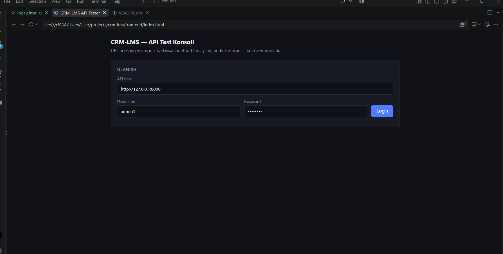
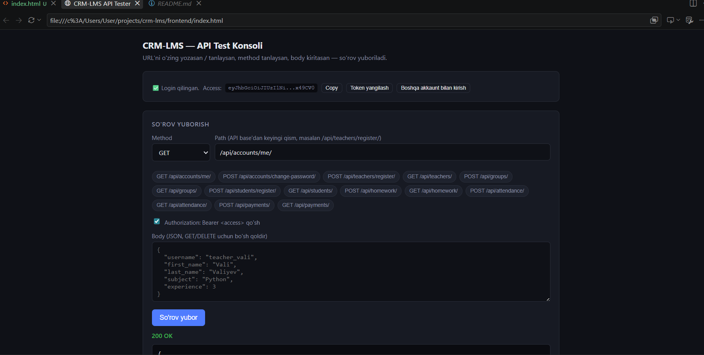
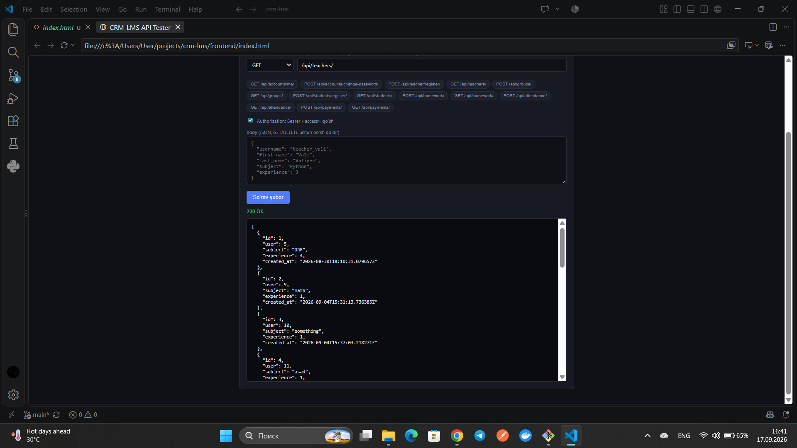
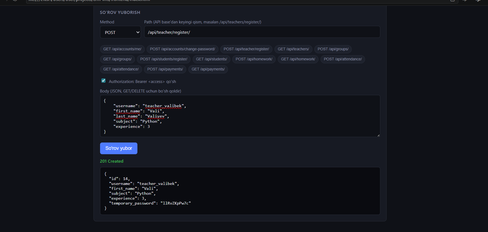
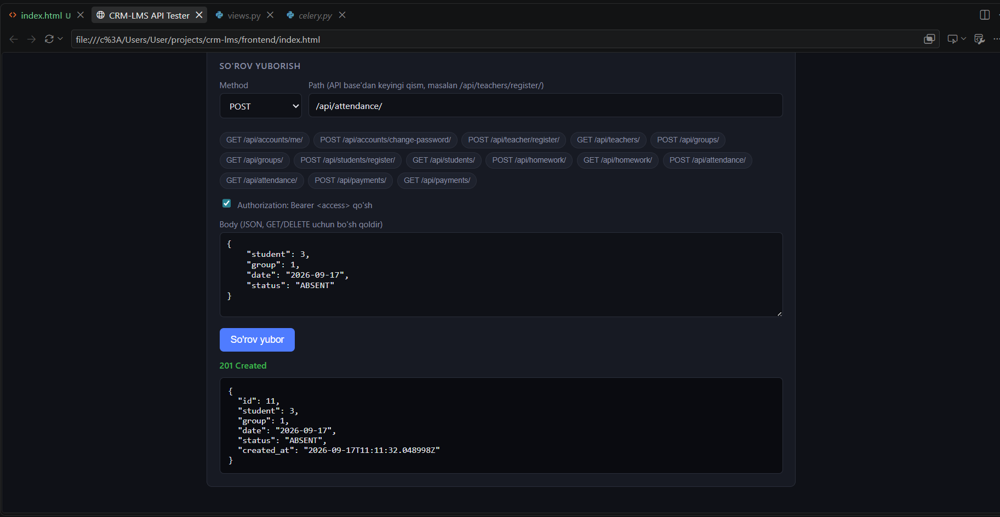
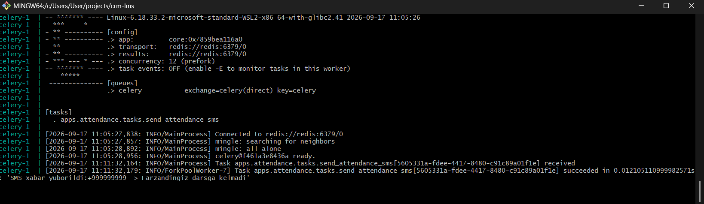
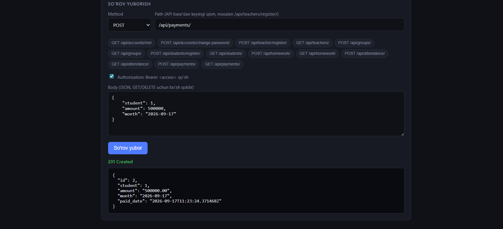
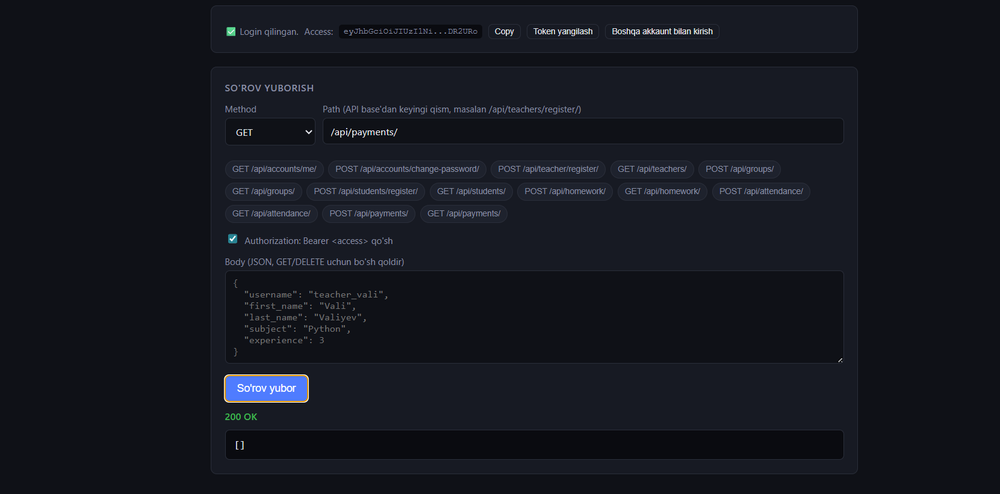

# CRM/LMS Backend

[O'zbekcha](#ozbekcha) | [English](#english)

<a id="ozbekcha"></a>

# CRM/LMS Backend — O'quv Markazi Boshqaruv Tizimi

O'quv markazlarini boshqarish uchun backend tizim: o'qituvchilar, o'quvchilar, guruhlar, uy vazifalari, davomat (simulyatsiya qilingan SMS xabarnoma bilan) va to'lovlar. Django REST Framework, rolga asoslangan ruxsatlar, Celery/Redis asosida qurilgan, bir vaqtdagi so'rovlardan (race condition) himoyalangan, testlar bilan qoplangan va to'liq Docker orqali konteynerlashtirilgan.

## Texnologiyalar

- **Backend:** Django, Django REST Framework
- **Baza:** PostgreSQL
- **Autentifikatsiya:** JWT (SimpleJWT)
- **Fon vazifalari:** Celery + Redis
- **Kesh:** Redis (django-redis)
- **Testlar:** pytest, pytest-django
- **Konteynerlashtirish:** Docker, docker-compose

## Rollar

`CustomUser` modelida uchta rol mavjud: **ADMIN**, **TEACHER**, **STUDENT**. Ochiq ro'yxatdan o'tish yo'q — har bir akkauntni faqat ADMIN yaratadi. ADMIN Teacher yoki Student yaratganda, tizim vaqtinchalik parol generatsiya qilib, javobda **bir marta** ko'rsatadi. Yangi foydalanuvchi parolni o'zgartirmaguncha (`/api/accounts/change-password/`), boshqa hech qanday endpoint'dan foydalana olmaydi — bu cheklov, maxsus `BaseViewSet` orqali, butun tizimda majburiy qilib qo'yilgan.

## App'lar

| App | Vazifasi |
|---|---|
| `accounts` | Autentifikatsiya (JWT), foydalanuvchi rollari, parolni o'zgartirish |
| `teachers` | O'qituvchi profillari, bitta so'rovda ro'yxatdan o'tkazish |
| `students` | Guruhlar (oylik narxi bilan), o'quvchi profillari, bitta so'rovda ro'yxatdan o'tkazish |
| `homework` | O'qituvchi tomonidan guruhga beriladigan uy vazifalari |
| `attendance` | Kunlik davomat + kelmagan holatda simulyatsiya qilingan SMS vazifasi (Celery, hali real gateway ulanmagan) |
| `payments` | O'quvchilarning oylik to'lovlari (bo'lib to'lash mumkin), qarzdorlar ro'yxati |

## Ruxsatlar Jadvali

| Resurs | Yaratish | Ko'rish | Tahrirlash/O'chirish |
|---|---|---|---|
| Teacher | Faqat Admin | O'zi yoki Admin | O'zi yoki Admin |
| Group | Faqat Admin | Admin, guruh o'qituvchisi, guruh o'quvchilari | Faqat Admin |
| Student | Faqat Admin | O'zi yoki Admin | O'zi yoki Admin |
| Homework | O'qituvchi (o'z guruhiga) yoki Admin | Admin, guruh o'qituvchisi, guruh o'quvchilari | Homework egasi (o'qituvchi) yoki Admin |
| Attendance | O'qituvchi (o'z guruhiga) yoki Admin | Admin, guruh o'qituvchisi, faqat o'zining yozuvi (student) | Admin, guruh o'qituvchisi |
| Payment | Faqat Admin | Admin hammasini; student faqat o'zinikini; o'qituvchi bo'sh ro'yxat ko'radi | Faqat Admin |

## Bir Vaqtdagi So'rovlardan Himoya (Race Condition)

Ikki so'rov bir vaqtda kelsa, tizim buzilmasligi uchun har bir xavfli joyda baza darajasida himoya qo'yilgan:

- **Davomat.** `student + group + date` uchun `UniqueConstraint` (bazaning o'zi takrorni rad etadi). Ikki so'rov aynan bir vaqtda kelsa, baza birini o'tkazadi, ikkinchisidagi `IntegrityError` ushlanib, 500 o'rniga 400 qaytariladi. SMS vazifasi `transaction.on_commit` bilan, ya'ni yozuv bazaga rostdan saqlangandan keyingina yuboriladi. Shuning uchun takroriy so'rovda ota-onaga ikkinchi SMS ketmaydi. Tahrirlashda (PATCH) ham xuddi shu: SMS faqat status `ABSENT` ga **o'zgarganda** ketadi.
- **To'lovlar.** Bo'lib to'lash mumkin, shuning uchun oddiy unique qoida yetmaydi. `transaction.atomic` ichida o'quvchining qatori `select_for_update` bilan qulflanadi (ikkinchi so'rov kutib turadi), keyin shu oy uchun to'langan jami summa hisoblanib, guruhning `monthly_fee` si bilan solishtiriladi. Tahrirlashda (PATCH) tahrirlanayotgan to'lovning o'zi hisobdan chiqarib tashlanadi, aks holda u ikki marta sanalardi.
- **Ro'yxatdan o'tkazish.** `User` va profil `transaction.atomic` ichida yaratiladi: yo ikkalasi saqlanadi, yo hech biri. Bir vaqtda kelgan bir xil `username` so'rovida `IntegrityError` ushlanadi va 500 chiqmaydi.

Bularning hammasi testlar bilan tekshirilgan (mock yordamida `IntegrityError` tashlatib, "hech narsa saqlanmadi va SMS ketmadi" holati ham sinalgan).

## Loyihani Ishga Tushirish

### Docker orqali (tavsiya etiladi)

```bash
docker-compose up --build
```

Bu, 4 ta konteynerni ishga tushiradi: `db` (PostgreSQL), `redis`, `web` (Django), `celery` (worker).

### Local (Docker'siz)

```bash
python -m venv venv
venv\Scripts\activate
pip install -r requirements.txt
python manage.py migrate
python manage.py runserver
```

Redis alohida ishlab turishi kerak (masalan `docker run -d -p 6379:6379 --name redis-crm redis` orqali), va Celery worker:
```bash
celery -A core worker --pool=solo -l info
```

### Muhit fayllari (.env)

- `.env` — local (venv) ishga tushirish uchun, `DB_HOST=localhost`, `redis_host=localhost`
- `.env.docker` — docker-compose uchun, `DB_HOST=db`, `redis_host=redis`

## Testlarni Ishga Tushirish

```bash
pytest
```

Faqat bitta app uchun: `pytest apps/payments/tests.py`. Test qamrovini ko'rish uchun: `pytest --cov`.

---

## API Endpointlari va Test So'rovlari

Asosiy manzil: `http://127.0.0.1:8000`

Barcha autentifikatsiya talab qiladigan so'rovlarda:
```
Authorization: Bearer <access_token>
```

### Accounts

**Login**
```
POST /api/accounts/login/
```
```json
{
    "username": "admin_user",
    "password": "admin_password"
}
```

**Token yangilash**
```
POST /api/accounts/login/refresh/
```
```json
{
    "refresh": "<refresh_token>"
}
```

**O'z profilimni ko'rish**
```
GET /api/accounts/me/
```

**Parolni o'zgartirish** (quyidagi ro'yxatdan o'tkazish endpointlari orqali yaratilgan Teacher/Student akkauntlari uchun, birinchi kirishdan keyin majburiy)
```
POST /api/accounts/change-password/
```
```json
{
    "old_password": "<vaqtinchalik_parol>",
    "new_password": "newSecurePass123",
    "confirm": "newSecurePass123"
}
```

---

### Teachers (O'qituvchilar)

**Yangi o'qituvchi ro'yxatdan o'tkazish (faqat Admin)** — User va Teacher profilini birgalikda yaratadi, bir martalik vaqtinchalik parolni qaytaradi.
```
POST /api/teacher/register/
```
```json
{
    "username": "teacher_vali",
    "first_name": "Vali",
    "last_name": "Valiyev",
    "subject": "Python",
    "experience": 3
}
```

**O'qituvchilar ro'yxati**
```
GET /api/teachers/
```

**Bitta o'qituvchini ko'rish**
```
GET /api/teachers/{id}/
```

**O'qituvchini tahrirlash** (o'zi yoki admin)
```
PATCH /api/teachers/{id}/
```
```json
{
    "subject": "Django REST Framework"
}
```

**O'qituvchini o'chirish** (o'zi yoki admin)
```
DELETE /api/teachers/{id}/
```

---

### Groups (Guruhlar)

**Guruh yaratish (faqat Admin)** — `monthly_fee` guruhning oylik narxi, to'lovlar limiti shunga qarab tekshiriladi.
```
POST /api/groups/
```
```json
{
    "name": "Python Backend - 1-guruh",
    "teacher": 1,
    "monthly_fee": 450000
}
```

**Guruhlar ro'yxati**
```
GET /api/groups/
```

**Guruhni ko'rish** (admin, shu guruh o'qituvchisi, yoki shu guruh o'quvchilari)
```
GET /api/groups/{id}/
```

**Guruhni tahrirlash / o'chirish (faqat Admin)**
```
PATCH /api/groups/{id}/
DELETE /api/groups/{id}/
```

---

### Students (O'quvchilar)

**Yangi o'quvchi ro'yxatdan o'tkazish (faqat Admin)** — User va Student profilini birgalikda yaratadi, bir martalik vaqtinchalik parolni qaytaradi.
```
POST /api/students/register/
```
```json
{
    "username": "student_dilnoza",
    "first_name": "Dilnoza",
    "last_name": "Karimova",
    "group": 1,
    "parent_phone": "+998901234567"
}
```

**O'quvchilar ro'yxati**
```
GET /api/students/
```

**O'quvchini ko'rish** (o'zi yoki admin)
```
GET /api/students/{id}/
```

**O'quvchini tahrirlash** (o'zi yoki admin)
```
PATCH /api/students/{id}/
```
```json
{
    "parent_phone": "+998907654321"
}
```

**O'quvchini o'chirish (faqat Admin)**
```
DELETE /api/students/{id}/
```

---

### Homework (Uy vazifalari)

**Uy vazifasi yaratish** — O'qituvchi (o'zi avtomatik biriktiriladi) yoki Admin (`teacher`ni ko'rsatishi shart)
```
POST /api/homework/
```

O'qituvchi sifatida:
```json
{
    "group": 1,
    "title": "Django ORM mashqlari",
    "description": "1-5 masalalarni yeching",
    "deadline": "2026-12-15T23:59:00Z"
}
```

Admin sifatida:
```json
{
    "group": 1,
    "teacher": 1,
    "title": "Django ORM mashqlari",
    "description": "1-5 masalalarni yeching",
    "deadline": "2026-12-15T23:59:00Z"
}
```

**Uy vazifalari ro'yxati** (admin, guruh o'qituvchisi, yoki guruh o'quvchilari)
```
GET /api/homework/
```

**Uy vazifasini ko'rish**
```
GET /api/homework/{id}/
```

**Uy vazifasini tahrirlash / o'chirish** (faqat bergan o'qituvchi yoki admin)
```
PATCH /api/homework/{id}/
DELETE /api/homework/{id}/
```

---

### Attendance (Davomat)

**Davomat belgilash** — O'qituvchi (faqat o'z guruhiga) yoki Admin. Agar `status` — `ABSENT` bo'lsa, Celery vazifasi ishga tushib, ota-onaga SMS "yuborilayotganini" simulyatsiya qiladi (hozircha faqat log qiladi — real SMS gateway ulanmagan).
```
POST /api/attendance/
```
```json
{
    "student": 1,
    "group": 1,
    "date": "2026-11-06",
    "status": "ABSENT"
}
```
Status variantlari: `PRESENT`, `ABSENT`, `LATE`. Sana oxirgi 7 kun ichida bo'lishi va kelajakda bo'lmasligi kerak (misoldagi sanani bugungi kunga yaqin sanaga almashtiring). Bir o'quvchi, bir guruh, bir kun uchun faqat bitta yozuv bo'lishi mumkin, takroriy so'rov 400 qaytaradi.

**Davomat ro'yxati** (admin, guruh o'qituvchisi, yoki o'quvchining o'zi — faqat o'z yozuvlari)
```
GET /api/attendance/
```

**Davomatni ko'rish**
```
GET /api/attendance/{id}/
```

**Davomatni tahrirlash / o'chirish** (admin yoki guruh o'qituvchisi)
```
PATCH /api/attendance/{id}/
DELETE /api/attendance/{id}/
```
Tahrirlashda `status` yuborilsa, u hozirgisidan farq qilishi kerak (bir xil bo'lsa 400). O'qituvchi yozuvni boshqa o'qituvchining guruhiga ko'chira olmaydi. SMS faqat status `ABSENT` ga o'zgarganda ketadi.

---

### Payments (To'lovlar)

**To'lov kiritish (faqat Admin)** — bo'lib to'lash mumkin: bir oy uchun bir nechta to'lov kiritsa bo'ladi, lekin jami summa guruhning `monthly_fee` sidan oshmasligi kerak (oshsa 400 va qolgan summa xabarda ko'rsatiladi).
```
POST /api/payments/
```
```json
{
    "student": 1,
    "amount": 200000,
    "month": "2026-11-01"
}
```
`amount` 0 dan katta bo'lishi kerak. `month` bugungi kundan 2 oydan ortiq orqada bo'lmasligi kerak.

**To'lovlar ro'yxati** (admin hammasini ko'radi; student faqat o'zinikini; o'qituvchi bo'sh ro'yxat oladi)
```
GET /api/payments/
```

**To'lovni ko'rish**
```
GET /api/payments/{id}/
```

**To'lovni tahrirlash / o'chirish (faqat Admin)** — summani oshirganda ham oylik limit tekshiriladi.
```
PATCH /api/payments/{id}/
DELETE /api/payments/{id}/
```

**Qarzdorlar ro'yxati (faqat Admin)** — tanlangan oy uchun to'liq to'lamaganlar.
```
GET /api/payments/debtors/?month=2026-11
```

---

## Dizayn Qarorlari Haqida

- **Ochiq ro'yxatdan o'tish yo'q.** Bu, o'quv markazining haqiqiy ishlash tartibiga mos — administrator akkauntlarni yaratadi, xuddi dasturchining o'zi o'qigan kurs markazi qanday login/parol berganidek.
- **Vaqtinchalik parol tizimi.** Admin hech qachon foydalanuvchining haqiqiy parolini bilmaydi yoki o'rnatmaydi. Tasodifiy parol generatsiya qilinib, bir marta ko'rsatiladi; foydalanuvchi o'z parolini o'rnatmaguncha, `/change-password/`dan tashqari hech qanday endpoint'ga kira olmaydi.
- **Birlashtirilgan ro'yxatdan o'tkazish endpointlari** (`/api/teacher/register/`, `/api/students/register/`) — `User` va profilni (`Teacher`/`Student`) ikkita alohida qadam o'rniga, bitta atomik so'rovda yaratadi.
- **Object-level ruxsatlar** butun loyihada qo'llanilgan (masalan, o'qituvchi faqat o'zining uy vazifasini tahrirlay oladi; o'quvchi faqat o'zining davomati/to'lovlarini ko'ra oladi) — faqat queryset filtrlashga tayanmasdan.
- **Ikki qavatli himoya.** Oddiy xatolar serializer'dagi tekshiruvda tez ushlanadi (masalan, takroriy davomat yoki limitdan oshgan to'lov). Haqiqiy himoya esa bazada: unique qoida va qator qulfi. Chunki ikki so'rov bir vaqtda kelsa, ikkalasi ham oldindan tekshiruvdan o'tib ketishi mumkin.
- **SMS xabarnomalari simulyatsiya qilingan, real emas.** Kelmagan holatda Celery vazifasi ishga tushib, "yuborilishi kerak bo'lgan" xabarni log qiladi — hali hech qanday SMS gateway ulanmagan. Bu — ataylab qilingan qaror (bitta SMS provayderi sinab ko'rilgan, lekin uning API'si ishonchsiz chiqqan), maqsad — uchinchi tomon integratsiyasi emas, Celery/Redis mexanikasiga e'tibor qaratish edi.


## Screenshots

**Login**


**Console**


**Teachers ro'yxati va yangi teacher qo'shish**



**Attendance — ABSENT belgilash va Celery SMS task**



**Payments**



---

<a id="english"></a>

# CRM/LMS Backend — Education Center Management System

A backend system for managing a private education center: teachers, students, groups, homework, attendance (with a simulated SMS notification task), and payments. Built with Django REST Framework, role-based permissions, Celery/Redis, protected against concurrent-request race conditions, covered by tests, and fully containerized with Docker.

## Tech Stack

- **Backend:** Django, Django REST Framework
- **Database:** PostgreSQL
- **Auth:** JWT (SimpleJWT)
- **Async tasks:** Celery + Redis
- **Caching:** Redis (django-redis)
- **Testing:** pytest, pytest-django
- **Containerization:** Docker, docker-compose

## Roles

Three roles exist on a single `CustomUser` model: **ADMIN**, **TEACHER**, **STUDENT**. There is no public self-registration — an ADMIN creates every account. When ADMIN creates a Teacher or Student, the backend generates a temporary password and returns it once in the response. The new user must change their password (`/api/accounts/change-password/`) before they can access any other endpoint — this is enforced globally via a custom `BaseViewSet`.

## Apps

| App | Responsibility |
|---|---|
| `accounts` | Auth (JWT), user roles, change-password flow |
| `teachers` | Teacher profiles, combined teacher registration |
| `students` | Groups (with a monthly fee), Student profiles, combined student registration |
| `homework` | Homework assigned by teachers to groups |
| `attendance` | Daily attendance tracking + simulated SMS task on absence (Celery, no real gateway yet) |
| `payments` | Monthly payment records per student (partial payments allowed), debtors list |

## Permissions Summary

| Resource | Create | View | Edit/Delete |
|---|---|---|---|
| Teacher | Admin only | Self or Admin | Self or Admin |
| Group | Admin only | Admin, group's teacher, group's students | Admin only |
| Student | Admin only | Self or Admin | Self or Admin |
| Homework | Teacher (own group) or Admin | Admin, group's teacher, group's students | Homework owner (teacher) or Admin |
| Attendance | Teacher (own group) or Admin | Admin, group's teacher, the student themself | Admin, group's teacher |
| Payment | Admin only | Admin sees all; a student sees only their own; a teacher gets an empty list | Admin only |

## Concurrency Safety (Race Conditions)

If two requests arrive at the same moment, each risky endpoint is protected at the database level:

- **Attendance.** A `UniqueConstraint` on `student + group + date` makes the database itself reject duplicates. When two requests race, the database lets one through and the other raises `IntegrityError`, which is caught and turned into a 400 instead of a 500. The SMS task is dispatched with `transaction.on_commit`, so it fires only after the record is truly saved, and a duplicate request never sends a second SMS. The same holds for updates (PATCH): the SMS is sent only when the status **changes** to `ABSENT`.
- **Payments.** Partial payments are allowed, so a plain unique constraint is not enough. Inside `transaction.atomic`, the student's row is locked with `select_for_update` (a second request waits), then the total paid for that month is calculated and compared with the group's `monthly_fee`. On update (PATCH), the payment being edited is excluded from the total, otherwise it would be counted twice.
- **Registration.** The `User` and the profile are created inside `transaction.atomic`: either both are saved or neither. If two requests with the same `username` race, `IntegrityError` is caught and no 500 is returned.

All of this is covered by tests, including mocked `IntegrityError` cases that verify "nothing was saved and no SMS was sent".

## Running the Project

### With Docker (recommended)

```bash
docker-compose up --build
```

This starts 4 containers: `db` (PostgreSQL), `redis`, `web` (Django), `celery` (worker).

### Locally (without Docker)

```bash
python -m venv venv
venv\Scripts\activate
pip install -r requirements.txt
python manage.py migrate
python manage.py runserver
```

Redis must be running separately (e.g. via `docker run -d -p 6379:6379 --name redis-crm redis`), and Celery worker via:
```bash
celery -A core worker --pool=solo -l info
```

### Environment files

- `.env` — used for local (venv) runs, `DB_HOST=localhost`, `redis_host=localhost`
- `.env.docker` — used by docker-compose, `DB_HOST=db`, `redis_host=redis`

## Running the Tests

```bash
pytest
```

A single app: `pytest apps/payments/tests.py`. With coverage: `pytest --cov`.

---

## API Endpoints & Test Requests

Base URL: `http://127.0.0.1:8000`

All authenticated requests need:
```
Authorization: Bearer <access_token>
```

### Accounts

**Login**
```
POST /api/accounts/login/
```
```json
{
    "username": "admin_user",
    "password": "admin_password"
}
```

**Refresh token**
```
POST /api/accounts/login/refresh/
```
```json
{
    "refresh": "<refresh_token>"
}
```

**Get my profile**
```
GET /api/accounts/me/
```

**Change password** (required after first login for Teacher/Student accounts created via the registration endpoints below)
```
POST /api/accounts/change-password/
```
```json
{
    "old_password": "<temporary_password>",
    "new_password": "newSecurePass123",
    "confirm": "newSecurePass123"
}
```

---

### Teachers

**Register a new teacher (Admin only)** — creates the User and Teacher profile together, returns a one-time temporary password.
```
POST /api/teacher/register/
```
```json
{
    "username": "teacher_vali",
    "first_name": "Vali",
    "last_name": "Valiyev",
    "subject": "Python",
    "experience": 3
}
```

**List teachers**
```
GET /api/teachers/
```

**Retrieve one teacher**
```
GET /api/teachers/{id}/
```

**Update teacher** (self or admin)
```
PATCH /api/teachers/{id}/
```
```json
{
    "subject": "Django REST Framework"
}
```

**Delete teacher** (self or admin)
```
DELETE /api/teachers/{id}/
```

---

### Groups

**Create group (Admin only)** — `monthly_fee` is the group's monthly price; the payment limit is checked against it.
```
POST /api/groups/
```
```json
{
    "name": "Python Backend - Group 1",
    "teacher": 1,
    "monthly_fee": 450000
}
```

**List groups**
```
GET /api/groups/
```

**Retrieve group** (admin, that group's teacher, or its students)
```
GET /api/groups/{id}/
```

**Update / Delete group (Admin only)**
```
PATCH /api/groups/{id}/
DELETE /api/groups/{id}/
```

---

### Students

**Register a new student (Admin only)** — creates the User and Student profile together, returns a one-time temporary password.
```
POST /api/students/register/
```
```json
{
    "username": "student_dilnoza",
    "first_name": "Dilnoza",
    "last_name": "Karimova",
    "group": 1,
    "parent_phone": "+998901234567"
}
```

**List students**
```
GET /api/students/
```

**Retrieve student** (self or admin)
```
GET /api/students/{id}/
```

**Update student** (self or admin)
```
PATCH /api/students/{id}/
```
```json
{
    "parent_phone": "+998907654321"
}
```

**Delete student (Admin only)**
```
DELETE /api/students/{id}/
```

---

### Homework

**Create homework** — Teacher (auto-assigned as owner) or Admin (must specify `teacher`)
```
POST /api/homework/
```

As a Teacher:
```json
{
    "group": 1,
    "title": "Django ORM Exercises",
    "description": "Complete exercises 1-5",
    "deadline": "2026-12-15T23:59:00Z"
}
```

As Admin:
```json
{
    "group": 1,
    "teacher": 1,
    "title": "Django ORM Exercises",
    "description": "Complete exercises 1-5",
    "deadline": "2026-12-15T23:59:00Z"
}
```

**List homework** (admin, group's teacher, or group's students)
```
GET /api/homework/
```

**Retrieve homework**
```
GET /api/homework/{id}/
```

**Update / Delete homework** (only the assigning teacher or admin)
```
PATCH /api/homework/{id}/
DELETE /api/homework/{id}/
```

---

### Attendance

**Mark attendance** — Teacher (own group only) or Admin. If `status` is `ABSENT`, a Celery task fires that simulates sending an SMS to the parent (currently just logs it — no real SMS gateway is connected).
```
POST /api/attendance/
```
```json
{
    "student": 1,
    "group": 1,
    "date": "2026-11-06",
    "status": "ABSENT"
}
```
Status options: `PRESENT`, `ABSENT`, `LATE`. Date must be within the last 7 days and not in the future (change the example date to one close to today). Only one record is allowed per student, group and day; a duplicate request returns 400.

**List attendance** (admin, group's teacher, or the student themself — only their own records)
```
GET /api/attendance/
```

**Retrieve attendance**
```
GET /api/attendance/{id}/
```

**Update / Delete attendance** (admin or group's teacher)
```
PATCH /api/attendance/{id}/
DELETE /api/attendance/{id}/
```
When `status` is sent in an update, it must differ from the current one (otherwise 400). A teacher cannot move a record to another teacher's group. The SMS is sent only when the status changes to `ABSENT`.

---

### Payments

**Record a payment (Admin only)** — partial payments are allowed: you can record several payments for one month, but the total must not exceed the group's `monthly_fee` (otherwise 400, and the remaining amount is shown in the message).
```
POST /api/payments/
```
```json
{
    "student": 1,
    "amount": 200000,
    "month": "2026-11-01"
}
```
`amount` must be greater than 0. `month` cannot be more than 2 months in the past.

**List payments** (admin sees all; student sees only their own; a teacher gets an empty list)
```
GET /api/payments/
```

**Retrieve payment**
```
GET /api/payments/{id}/
```

**Update / Delete payment (Admin only)** — the monthly limit is enforced on updates too.
```
PATCH /api/payments/{id}/
DELETE /api/payments/{id}/
```

**Debtors list (Admin only)** — students who have not paid in full for the chosen month.
```
GET /api/payments/debtors/?month=2026-11
```

---

## Notes on Design Decisions

- **No self-registration.** Matches how the education center actually onboards people — admin creates accounts, similar to how the developer's own course provider issued credentials.
- **Temporary password flow.** Admin never sets or knows a user's real password. A random password is generated and shown once; the user is locked out of every endpoint except `/change-password/` until they set their own.
- **Combined registration endpoints** (`/api/teacher/register/`, `/api/students/register/`) create the `User` and the profile (`Teacher`/`Student`) in a single atomic request instead of two separate steps.
- **Object-level permissions** are used throughout (e.g. a teacher can only edit their own homework; a student can only see their own attendance/payments) rather than relying on queryset filtering alone.
- **Two layers of protection.** Common mistakes are caught early in serializer validation (e.g. a duplicate attendance or a payment over the limit). The real guarantee lives in the database: unique constraints and row locks. This is because two simultaneous requests can both pass the early validation.
- **SMS notifications are simulated, not real.** A Celery task runs on absence and logs what *would* be sent — no SMS gateway is integrated yet. This was a deliberate scope cut (an SMS provider was tried but its API was unreliable) to keep focus on the Celery/Redis mechanics rather than a third-party integration.

## Screenshots

**Login**


**Console**


**Teachers list and registering a new teacher**


**Attendance — marking ABSENT and the Celery SMS task**


**Payments**

